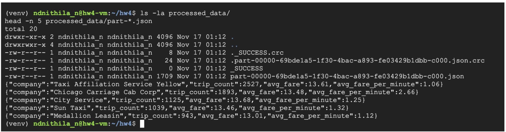

# Readme

For HW4, I cleaned the Chicago taxi dataset to 10k trips and loaded that into Neo4j. I used PySpark to calculate the fare per minute and ge tthe trip counts and average fares for each company. The results were saved as JSON in the processed_data folder. The screenshot is shown below of the preprocessing output including the _SUCSESS file and the JSON records.

Preprocessing output: 

